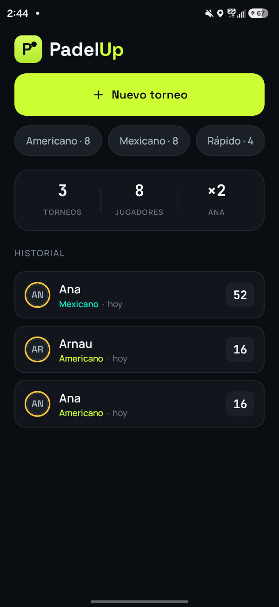
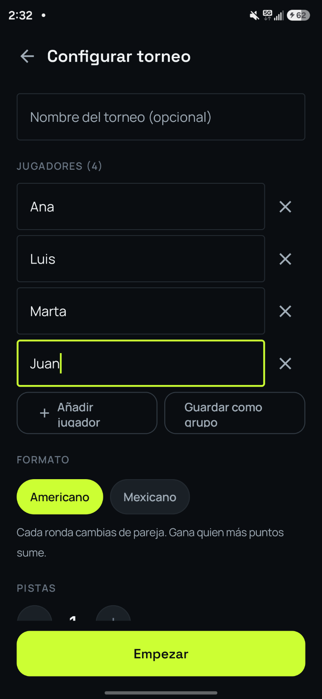
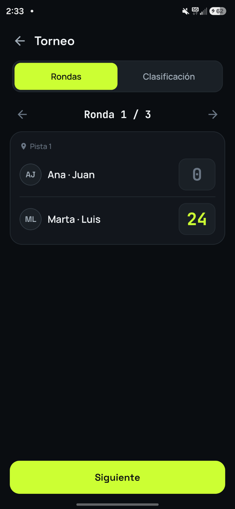
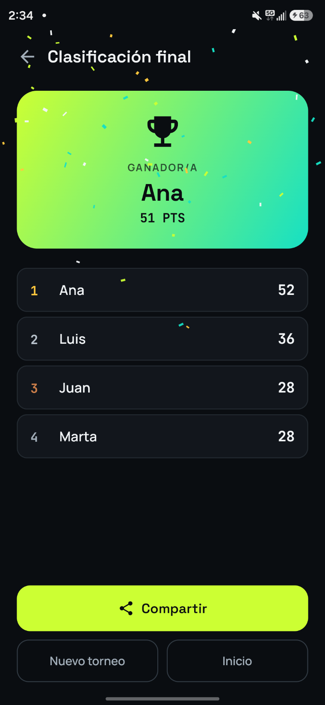

# PadelUp

Runs our padel tournaments so nobody has to do the maths on a napkin.

Every so often a group of friends and I play an Americano or a Mexicano: a handful of players, a couple of courts, partners that change every round. Someone always ends up with a pen and a crumpled sheet working out who plays next. So I built a native Android app that does the pairings, keeps the live standings and crowns the winner. It works offline, with no accounts and no server.

  
  
  
  

The UI is in Spanish, and the player names in the screenshots are placeholders.

## What it does

- Americano (partners change every round) and Mexicano (pairings follow the live ranking).
- Players, courts and rounds are configurable, including an "everyone partners everyone" default.
- Scoring per game can be a fixed total (say 16-8 out of 24), a race to N points, or free.
- Standings update after each round, with arrows for who moved up or down. Tiebreak is point difference or games won, your pick.
- When there are more players than court spots, rests are rotated fairly.
- It keeps saved player groups and a history, lets you resume or discard a tournament, and ends with a podium, confetti and a shareable text result.

## How the pairing works

The scheduling and ranking live in a small engine with no Android dependencies, covered by unit tests.

For Americano, the whole schedule is built up front. Each round, the players with the fewest games play and the rest sit out, which keeps rests fair. Then a randomised greedy search builds the matches: it pairs each player with the partner they've shared a court with least, then matches pairs against the opponents they've faced least. It repeats that 160 times and keeps the cheapest result, where a repeated partner costs three times as much as a repeated rival. It isn't optimal, but it's simple and fast, and it holds up with big groups where a full combinatorial search wouldn't.

Mexicano is simpler. Round one is generated like an Americano round, and after that each round comes from the standings: whoever has played the most rests first, and the rest are taken in ranking order in groups of four, with 1st and 4th against 2nd and 3rd to keep games balanced.

One bug is worth telling. My first version broke ties in the sort with a random value inside the comparator. That violates the comparator contract, and with 32 or more players the sort crashed. Now I shuffle once and use a stable sort, and there's a regression test for it. Another detail: an empty score is `null`, not `0`, so a game only counts once both sides have a score.

Standings are ranked by points, then the chosen tiebreak, then by name so the order is always deterministic. The position arrows come from recomputing the standings without the last round and comparing, so no extra history is stored.

[`excerpts/Pairing.kt`](excerpts/Pairing.kt) and [`excerpts/Standings.kt`](excerpts/Standings.kt) have the engine code. The model classes they use aren't included, so they won't build on their own.

## Built with

Kotlin, Jetpack Compose and Material 3, kotlinx.serialization with SharedPreferences, a single activity with a small custom navigation stack, and JUnit for the engine. Confetti and the logo are drawn on Canvas. It runs on Android 7 and up, and I've tested it on my own phone.

## What I'd do next

- English localisation and better accessibility.
- A settings screen with a light theme.
- Maybe the Play Store, if people other than my friends start asking for it.

---

The full source is private. This repo shows how it works and a few pieces of the code; happy to walk through the rest.

© 2026 Arnau Mas
